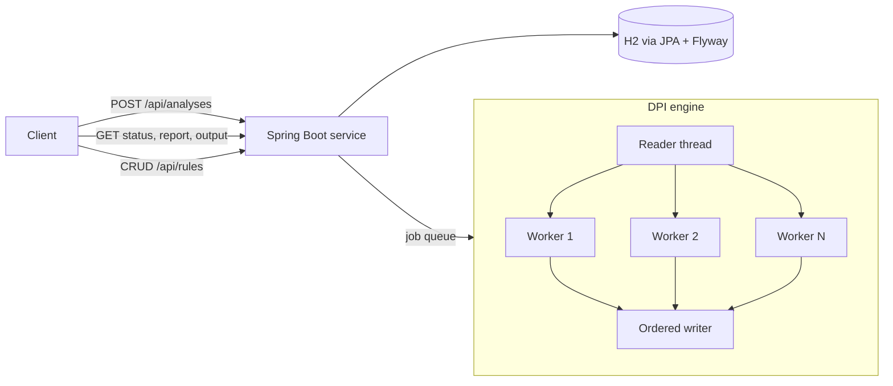

# DPI Platform

[](https://github.com/akanksha70/dpi-platform/actions/workflows/ci.yml)

A deep packet inspection (DPI) engine with a REST API, written in Java. Upload a packet capture
(`.pcap`) and the service identifies which applications generated the traffic (YouTube, Netflix,
GitHub, ...) from the domain names visible in TLS and HTTP handshakes, applies block rules, and
returns a JSON report together with a filtered capture.

## Features

- Parses Ethernet, IPv4, TCP and UDP headers by hand, with no packet library.
- Reads the server name (SNI) from TLS Client Hello packets and the `Host` header from HTTP.
- Classifies traffic with a data-driven signature file (`signatures.txt`), matching whole domains
  and their subdomains only.
- Blocks by IP address, application or domain, in both directions of a connection.
- Processes packets on multiple worker threads while keeping every packet of a connection on the
  same worker, and writes the filtered capture in the original packet order.
- REST API with asynchronous jobs, persistent block rules, and stored results.

## Architecture



Two Maven modules:

| Module | Contents |
|---|---|
| `engine` | PCAP reader and writer, packet parser, SNI and HTTP Host extractors, classifier, rules, multi-threaded engine. Plain Java, no Spring. |
| `service` | Spring Boot 4 REST API, job handling, JPA persistence, Flyway migrations, scheduled cleanup. |

## Run it

Requirements: Java 21 and Maven (on Windows, use WSL).

```
mvn -q package -DskipTests
java -jar service/target/dpi-service-1.0-SNAPSHOT.jar
```

The server listens on port 8080. Data is stored in `./data` (an H2 database file plus the
uploaded and filtered captures).

## API

| Method and path | Purpose |
|---|---|
| `POST /api/analyses` | Upload a capture (multipart field `file`). Optional repeatable fields `blockApp`, `blockIp`, `blockDomain`, and `applyStoredRules=false`. Returns `202` with a job id. |
| `GET /api/analyses/{id}` | Job status (`QUEUED`, `RUNNING`, `COMPLETED`, `FAILED`) and a summary. |
| `GET /api/analyses/{id}/report` | Full report: totals, per-application counts, detected domains, flows. |
| `GET /api/analyses/{id}/output` | Download the filtered capture. |
| `GET /api/analyses` | Recent jobs. |
| `GET /api/rules`, `POST /api/rules`, `DELETE /api/rules/{id}` | Stored block rules, applied to every new analysis. |

Example:

```
curl -X POST http://localhost:8080/api/rules \
     -H "Content-Type: application/json" -d '{"type":"APP","value":"Twitter/X"}'

curl -X POST http://localhost:8080/api/analyses -F "file=@capture.pcap"
```

Errors use RFC 9457 problem details. Files that are not PCAP are rejected with `400` before any
work is queued, reports return `409` until a job has finished, and a download whose file has been
cleaned up returns `410`.

## Design notes

- **Flows are direction-independent.** Both directions of a connection share one flow key, so a
  connection classified from the client's first packet is also blocked for the server's replies.
- **Even work distribution.** Each packet goes to one worker chosen from a mixed hash of its flow
  key, so all packets of a connection are handled by the same worker without locking.
- **Ordered output.** Workers finish out of order; a single writer holds packets until it can
  write them in the original sequence.
- **Clean shutdown.** Workers stop on a marker placed after the last packet, so nothing queued is
  lost; internal errors in one packet forward it instead of silently dropping traffic.
- **Whole-domain matching.** A rule for `x.com` matches `x.com` and `www.x.com`, never
  `netflix.com`. Signatures live in a text file, not in code.
- **Jobs survive restarts.** Jobs and reports are stored in the database. Jobs interrupted by a
  restart are marked `FAILED` on startup, and jobs older than 24 hours are removed together with
  their files.
- **Bounded reports.** Domain and flow lists in a report are capped at 1000 entries, with totals
  and a `truncated` flag, so one huge capture cannot produce an unstorable report.
- **Schema under version control.** The database schema is created by Flyway migrations, not by
  Hibernate.

## Testing

Run with `mvn test`:

- unit tests for each parsing and matching component, using a real sample capture;
- engine tests covering totals, application detection, ordering of the output, blocking, and
  results being independent of the number of workers;
- HTTP tests without a server (MockMvc) and against the real application context;
- persistence tests against a real database with the Flyway migrations applied;
- tests for restart recovery and job expiry.

## Limitations

- Offline analysis of saved captures only; there is no live capture.
- Detection is signature-based: unknown apps appear as generic HTTPS, and encrypted client hello
  or DNS-over-HTTPS hides the domain. A Client Hello split across several TCP segments is not
  reassembled, so some domains are missed.
- IPv4 only; QUIC is not decoded.
- No authentication. Single instance, local file storage, H2 as the default database.
